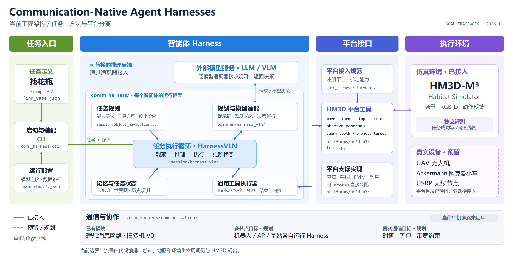

# 当前目录与三层边界



[可编辑矢量图](examples/architecture.svg)。实线表示当前单机链路；设备预留及通信规划在图中单独注明。图中的层次表示职责，具体目录以各模块标注为准。

## 先区分任务、方法和平台

- **任务实例**回答这一次做什么：`examples/find_vase.json` 选择原始 episode、agent、目标和步数预算。
- **任务类型**回答这类任务有哪些要求：`comm_harness/session/object_navigation.py` 声明导航所需能力、工具许可与停止检查。基准成功与否由平台的独立评测器判定。
- **求解方法**回答怎样完成任务：`comm_harness/session/harness_vln/` 组织观察、决策、移动、回退和停止复核；`planner/harness_vln/` 组织模型输入并解析决策。
- **平台能力**回答设备实际能做什么：`platforms/hm3d_m3/tools.py` 实现观察、移动、深度查询等操作。

任务实例是配置，不是一套新的 harness。任务类型与求解方法属于现有的 session/planner 层，无需增加一级目录。公共 `tools/` 提供注册、检查、执行和回执，不按任务名称建子目录；共享的任务状态仍由 session 管理。

```text
examples/find_vase.json + 运行配置
               │
          cli 装配一次运行
               │
    session：任务规则 + 方法流程 ←→ planner：模型决策
               │
       tools：校验、分派、回执
               │
   platforms/hm3d_m3：能力实现 → 仿真环境
```

目前 HarnessVLN 的阶段流程由代码编排，模型在各阶段作决策；尚不是让模型自由组合任意工具的通用循环。`ObjectNavigationTask` 已独立于 Habitat 导入，但所需能力及停止规则仍以当前导航方法为基础，尚不是已经验证适配全部设备的通用任务接口。

同类任务换目标，只新增任务 JSON。真正新增任务类型（如无线测绘），在 session 增加该类型的规则和流程，按需增加 planner 策略，接入 CLI；缺失的设备能力写到相应平台。已有公共工具执行机制可继续复用。具体字段见 [任务定义说明](examples/TASKS.md)。

## 已实现的边界

2026-11-08 已将工具运行机制、任务停止规则和 HM3D 工具实现拆开：

| 层面 | 当前入口 | 所有权 |
| --- | --- | --- |
| 公共 harness | `comm_harness/tools/{contracts,registry,runtime,executor}.py` | 工具协议、绑定、参数/许可检查、执行、日志与回执 |
| 任务 | `comm_harness/session/object_navigation.py` | 导航所需能力、许可集合、停止条件；导航编排仍在 evaluator |
| 平台 | `platforms/hm3d_m3/tools.py` | HM3D 动作、深度测量、坐标投影 |

实际调用：`evaluator → ToolExecutor → 已注册的 HabitatTools → Habitat/投影实现`。停止检查由 `ObjectNavigationTask` 读取平台深度事实后应用任务门限，最终成功仍由 Habitat 独立评测。

这一步建立了真实工具接口；感知、地图和环境生命周期仍有 HM3D 依赖，尚未实现任意任务/平台只换配置。旧多机 V0 尚未统一到新执行器。接口、扩展方式和验证记录见 [三层边界说明](examples/HARNESS_LAYERS.md)。

项目：Communication-Native Agent Harnesses for Multi-Robot Embodied Intelligence。

已按以下层级实现第一版。`192.168.31.225:/home/pyq/comm_harness/` 为框架开发主目录，后续修改和联调以服务器代码为准；本机 `code/` 保留为同步副本。RPent 参考源码单独放在服务器 `/home/pyq/RPent/`。

当前工作转为 **HarnessVLN 单机闭环**。下列一级目录保持不变；具体源码分别放在 `comm_harness/planner/harness_vln/`、`comm_harness/session/harness_vln/`、`comm_harness/tools/`、`platforms/hm3d_m3/harness_vln/`，Habitat 扩展放在 `platforms/hm3d_m3/habitat/`。逐文件位置见 [HARNESS_VLN_FILES.md](examples/HARNESS_VLN_FILES.md)。多机 V0 代码保留，单机入口不调用通信模块。

```text
code/
├── comm_harness/          # 公共框架
│   ├── cli/              # 命令行启动与终端交互
│   ├── dashboard/        # Web 页面、HTTP 接口与界面共享状态
│   ├── telemetry.py      # 依赖轻量的执行事件、耗时与心跳记录
│   ├── planner/          # 推理后端
│   ├── tools/            # 公共工具机制
│   ├── platforms/        # 平台接入规范
│   ├── session/          # 运行流程与状态
│   └── communication/    # 节点通信与基础协作
│
├── platforms/            # 具体平台实现
│   ├── hm3d_m3/          # HM3D-M³ 多机器人仿真
│   ├── uav/              # 无人机
│   ├── ackermann/        # 阿克曼底盘
│   └── usrp/             # USRP
│
├── examples/             # 使用示例
└── tests/                # 测试
```

沿用 RPent 的“公共框架 + 具体平台实现”划分，将 robots 改为 platforms。通信相关能力统一放在 communication 下。

Web / CLI 的目录、共用逻辑和启动方式见 [界面说明](examples/INTERFACES.md)。界面读取任务定义并启动现有 worker；规划、任务规则与平台执行仍由各自模块负责。

监控是旁路读取：`telemetry.py` 记录实际发生的阶段、模型请求、工具执行和节点心跳，写入运行目录 `monitor.jsonl`；`dashboard/monitoring.py` 增量读取并生成 Web/CLI 共用视图。任务定义仍归 `examples/`，平台感知和控制仍归 `platforms/`。监控数据不回写规划上下文，也不把私有评测真值交给模型。旧多机日志继续使用 `events.jsonl`，通过读取适配展示理想消息传输；尚未为分布式节点实现日志汇聚服务。

两个 platforms 的职责分别为：

- comm_harness/platforms：定义各种平台共同遵循的接入规范。
- 顶层 platforms：实现无人机、阿克曼底盘和 USRP 的具体接入。

上述一级目录保持不变，具体工具实现优先放在对应平台的 `tools.py`。目前仅 HM3D 接通；无人机、阿克曼底盘和 USRP 仍是预留目录。

HM3D-M³ 的设计依据见 [V0 设计](examples/HM3D_M3_V0_DESIGN.md)，实际实现、启动方式和限制见 [README](README.md)。第一版已经包含 DeepSeek 工具循环、独立节点、理想通信、RGB-D/FMM 导航以及隔离的仿真与评测进程。

当前任务实例入口是 `examples/find_vase.json`，模型配置通过 `task_file` 引用它，也可用 `--task` 替换。见 [任务定义说明](examples/TASKS.md)。公共工具目录已经移除导航专用子包。
