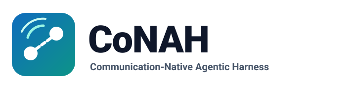
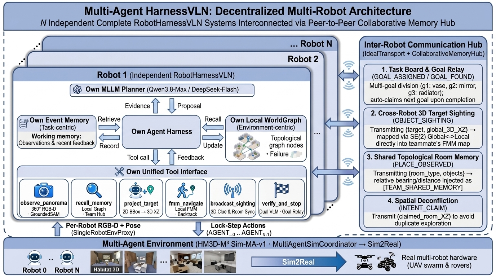

<div align="center">
  
</div>

<div align="center">
  <a href="https://conah.readthedocs.io/en/latest/"></a>
  <a href="https://conah.readthedocs.io/zh-cn/latest/"></a>
  <a href="LICENSE"></a>
  
</div>

<div align="center">

[](README.md)
[](README.zh-CN.md)

</div>

<h1 align="center">
  <sub>CoNAH: A Communication-Native Agentic Harness for Multi-Robot Embodied Intelligence</sub>
</h1>

**CoNAH (Communication-Native Agentic Harness)** is an open-source infrastructure for building decentralized multi-robot embodied agents that perceive, reason, remember, and collaborate over realistic wireless communication channels.

Unlike single-agent frameworks or centralized multi-agent scripts that silently share Python memory, **CoNAH** elevates **inter-robot communication** to a first-class, verifiable Harness primitive: every robot runs its own isolated `AgentSession`, `Planner`, `Toolkit`, and `WorldGraph`, while all cross-robot interactions pass through serialized wire `Envelope` packets governed by pluggable channel models (`IdealChannel`, `ImpairedChannel`, `BlackoutChannel`, or real **USRP** software-defined radios).

<div align="center">
  
</div>

---

## Key Highlights

- **Service-Oriented Process Isolation**: Separates robot brains (`AgentSession` + `Planner`) from physical/simulation servers (`env_server`) and channel brokers (`comm_server`) via lightweight HTTP JSON-RPC (`comm_harness/rpc.py`), eliminating Python/CUDA dependency conflicts.
- **First-Class Communication Tools**: Automatically equips every robot's `Toolkit` with `comm_send`, `comm_broadcast`, `comm_poll`, and `comm_status`, backed by verifiable `NETWORK_TX` receipts and zero-violation runtime auditing (`HarnessRuntime`).
- **Pluggable Wireless Channel Simulation & Sim2Real**: Switch seamlessly between `IdealChannel`, `ImpairedChannel` (token-bucket bandwidth limits, MTU caps, packet loss, latency/jitter, Euclidean range cutoffs), `BlackoutChannel` (`No-Comm` ablation), and real USRP/ROS2 transceivers without changing a single line of agent code.
- **Structured Spatial & Task Memory**: Per-robot topological `WorldGraph` (`Place` / `Object` / `Failure` nodes with IDF + 1-hop recall) paired with dynamic multi-goal task relay (`GOAL_ASSIGNED`, `OBJECT_SIGHTING` 3D `SE(2)` FMM projection, `PLACE_OBSERVED`, `INTENT_CLAIM`).

---

## Feature Matrix

<table width="100%">
  <thead>
    <tr>
      <th>Agentic Planners</th>
      <th>Communication & Channels</th>
      <th>Simulation Platforms</th>
      <th>Real-World Hardware</th>
    </tr>
  </thead>
  <tbody valign="top">
    <tr>
      <td>
        <ul>
          <li><b>API Planner</b> (OpenAI / Qwen / Claude / DeepSeek / vLLM / Ollama) ✅</li>
          <li><b>Codex MCP Planner</b> ✅</li>
          <li><b>Flash / Scripted Replay</b> ✅</li>
        </ul>
      </td>
      <td>
        <ul>
          <li><b>Tools</b>: <code>comm_send</code>, <code>comm_broadcast</code>, <code>comm_poll</code>, <code>comm_status</code> ✅</li>
          <li><b>Channels</b>:
            <ul>
              <li><code>IdealChannel</code> ✅</li>
              <li><code>ImpairedChannel</code> (Loss / BW / Delay / Range) ✅</li>
              <li><code>BlackoutChannel</code> (No-Comm) ✅</li>
            </ul>
          </li>
        </ul>
      </td>
      <td>
        <ul>
          <li><b>GridWorld 2D</b> (Zero-GPU Multi-Process RPC) ✅</li>
          <li><b>HM3D-M³</b> (3D Multi-Robot Collaborative VLN) ✅</li>
        </ul>
      </td>
      <td>
        <ul>
          <li><b>USRP SDR</b> (<code>CommEndpoint</code> Interface) 🚧</li>
          <li><b>UAV Swarm / Ackermann UGV</b> 🚧</li>
        </ul>
      </td>
    </tr>
  </tbody>
</table>

---

## Quickstart (30 Seconds, Zero GPU Required)

**1. Install CoNAH core.**

```bash
git clone https://github.com/your-org/CoNAH.git && cd CoNAH
pip install -e .
```

**2. Run a 2-robot multi-process cooperative search over localhost IPC (`127.0.0.1`).**

Two independent OS processes (`robot_0` and `robot_1`) connect to `GridEnvServer` and `LocalhostCommServer`, exchange opportunistic target sightings via `comm_broadcast` / `comm_poll`, and achieve `team_sr = 1.0` with `0` harness violations:

```bash
# Ideal intra-machine channel (Team SR = 1.0)
python3 -m tasks.coop_grid_search.demo --channel ideal

# Constrained wireless channel (30% packet loss, 500 B/s bandwidth cap)
python3 -m tasks.coop_grid_search.demo --channel impaired --drop-prob 0.3 --bandwidth-bps 500

# No-Comm ablation baseline (Team SR = 0.0)
python3 -m tasks.coop_grid_search.demo --channel blackout
```

**3. Drive the multi-process robots with a live LLM (`api` planner).**

```bash
export OPENAI_BASE_URL="https://dashscope.aliyuncs.com/compatible-mode/v1"
export OPENAI_API_KEY="sk-xxx"

# Verify LLM connectivity first
conah-check-llm --planner api --model openai-chat:qwen3.8-max

# Run live LLM multi-agent collaboration
python3 -m tasks.coop_grid_search.demo --planner api --model openai-chat:qwen3.8-max
```

**4. Launch the Live Monitor Dashboard.**

```bash
pip install -e ".[ui]"
conah --dashboard --dashboard-language zh-cn
```

---

## Repository Structure

```text
CoNAH/
├── comm_harness/          # Pure platform-agnostic & task-agnostic core harness
│   ├── cli/               # Unified CLI (`conah`, `conah-check-llm`) & TUI
│   ├── communication/     # Wire Envelope, ChannelModels, Localhost IPC & CommTools
│   ├── dashboard/         # Live Agent Command & Status Monitor (Web UI)
│   ├── memory/            # Topological WorldGraph, IDF Recall & TodoMemory
│   ├── planner/           # API / Codex / Flash tool-calling loops & token budgets
│   ├── session/           # AgentSession, TeamSession & EnvState lifecycle
│   ├── tools/             # @tool, Toolkit, ToolRegistry & HarnessRuntime receipts
│   └── rpc.py             # Stdlib HTTP JSON-RPC server/client (`127.0.0.1` / LAN)
├── platforms/             # Concrete simulator & hardware integrations (`PlatformSpec`)
│   ├── grid_world/        # Zero-GPU 2D multi-robot RPC environment
│   └── hm3d_m3/           # Habitat HM3D-M³ 3D perception, FMM & multi-agent sim
├── tasks/                 # Task policies, collaborative protocols & benchmarks
│   ├── coop_grid_search/  # Multi-process localhost IPC cooperative search
│   ├── harness_vln/       # Single-robot 3D ObjectNav / TextNav
│   └── multi_harness_vln/ # Multi-robot multi-goal 3D collaborative VLN
└── docs/                  # Bilingual (EN / ZH) Sphinx documentation source
```

---

## License

CoNAH is released under the [Apache-2.0 License](LICENSE).
