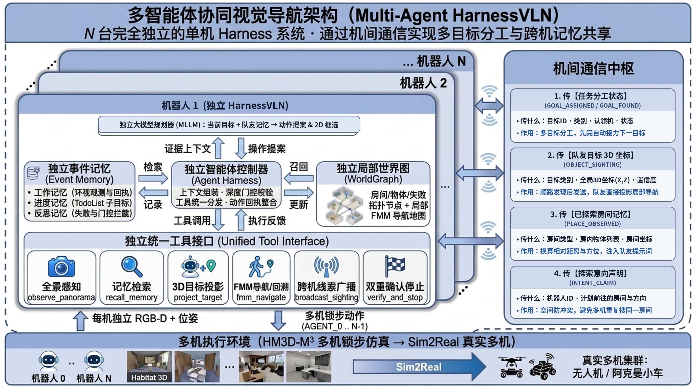

<div align="center">
  
</div>

<div align="center">
  <a href="https://conah.readthedocs.io/en/latest/"></a>
  <a href="https://conah.readthedocs.io/zh-cn/latest/"></a>
  <a href="LICENSE"></a>
  
</div>

<div align="center">

[](README.md)
[](README.zh-CN.md)

</div>

<h1 align="center">
  <sub>CoNAH：面向多机器人具身智能的通信原生智能体控制框架</sub>
</h1>

**CoNAH (Communication-Native Agentic Harness)** 是一个面向多机器人具身智能的开源基础设施，使多台异构智能体能够在受限无线信道中完成分布式感知、推理、拓扑记忆构建与跨机协同执行。

与单智能体框架或在单进程内隐式共享 Python 内存的多机脚本不同，**CoNAH** 将**机间通信（Inter-Robot Communication）**提升为与感知、规划、记忆平级的一等公民原语：每台机器人运行完全独立的 `AgentSession`、`Planner`、`Toolkit` 与本地 `WorldGraph`，所有跨机协作均必须封装为标准字节流信封（`Envelope`），经由可插拔无线信道模型（理想信道、带宽/丢包/距离受限信道、断联基线或真实 **USRP** 软件无线电）完成传输与回执审计。

<div align="center">
  
</div>

---

## 核心特性

- **服务化进程解耦（机内 RPC vs. 机间无线信道分离）**：通过零外部依赖的 HTTP JSON-RPC（`comm_harness/rpc.py`）将智能体大脑进程与物理环境服务（`env_server`）、无线信道仿真服务（`comm_server`）解耦，彻底消除不同仿真器与模型库之间的 Python/CUDA 环境冲突。
- **一等公民通信工具集（First-Class CommTools）**：每台机器人的 `Toolkit` 原生挂载 `comm_send`、`comm_broadcast`、`comm_poll`、`comm_status` 四个标准工具，发包操作自动生成 `NETWORK_TX` 回执并接受 `HarnessRuntime` 零违规闭环审计。
- **可插拔无线信道损伤与 Sim2Real 无缝切换**：无需改动任何智能体上层代码，即可在 `IdealChannel`（理想上限）、`ImpairedChannel`（支持 MTU 上限、令牌桶带宽限速、随机丢包、延迟抖动与距离衰减）、`BlackoutChannel`（零通信消融）以及真实 **USRP** 电台之间一键切换。
- **空间拓扑记忆与跨机 3D 线索投影**：每机维护独立的 `WorldGraph`（`Place` / `Object` / `Failure` 节点及本地 IDF 检索），结合动态任务板接力与跨机 3D 坐标 `SE(2)` 局部 FMM 直接投影导航。

---

## 功能矩阵

<table width="100%">
  <thead>
    <tr>
      <th>智能体规划器 (Planners)</th>
      <th>通信工具与信道仿真</th>
      <th>仿真环境 (Simulators)</th>
      <th>真实硬件接入 (Sim2Real)</th>
    </tr>
  </thead>
  <tbody valign="top">
    <tr>
      <td>
        <ul>
          <li><b>API Planner</b> (Qwen / OpenAI / Claude / DeepSeek / Ollama) ✅</li>
          <li><b>Codex MCP Planner</b> ✅</li>
          <li><b>Flash / 脚本重放模式</b> ✅</li>
        </ul>
      </td>
      <td>
        <ul>
          <li><b>标准工具</b>: <code>comm_send</code>, <code>comm_broadcast</code>, <code>comm_poll</code>, <code>comm_status</code> ✅</li>
          <li><b>信道模型</b>:
            <ul>
              <li><code>IdealChannel</code> (理想无损) ✅</li>
              <li><code>ImpairedChannel</code> (丢包/限速/延迟/距离截断) ✅</li>
              <li><code>BlackoutChannel</code> (断联消融) ✅</li>
            </ul>
          </li>
        </ul>
      </td>
      <td>
        <ul>
          <li><b>GridWorld 2D</b> (零 GPU 多进程本机 RPC 验证环境) ✅</li>
          <li><b>HM3D-M³</b> (3D 室内多机多目标协同视觉导航) ✅</li>
        </ul>
      </td>
      <td>
        <ul>
          <li><b>USRP 软件无线电</b> (<code>CommEndpoint</code> 接口) 🚧</li>
          <li><b>UAV 无人机集群 / 阿克曼小车</b> 🚧</li>
        </ul>
      </td>
    </tr>
  </tbody>
</table>

---

## 快速开始（无需 GPU，30 秒跑通多进程通信闭环）

**1. 安装 CoNAH 核心包。**

```bash
git clone https://github.com/ppppyq/CoNAH.git && cd CoNAH
pip install -e .
```

**2. 运行本机跨进程（`127.0.0.1`）双机器人协同搜索。**

启动独立的环境服务端（`GridEnvServer`）、信道仿真服务端（`LocalhostCommServer`）以及两个独立的操作系统子进程（`robot_0` 与 `robot_1`），验证跨机顺路目击广播与零违规回执审计：

```bash
# 1) 理想信道：两机互换顺路发现的目标坐标，6 步直达各自目标 (team_sr = 1.0)
python3 -m tasks.coop_grid_search.demo --channel ideal

# 2) 受限信道实验：模拟 30% 随机丢包与 500 Byte/s 带宽限速
python3 -m tasks.coop_grid_search.demo --channel impaired --drop-prob 0.3 --bandwidth-bps 500

# 3) 断联消融基线：信道阻断所有跨机包 (team_sr = 0.0)
python3 -m tasks.coop_grid_search.demo --channel blackout
```

**3. 接入真实大模型驱动双进程协同推理。**

```bash
export OPENAI_BASE_URL="https://dashscope.aliyuncs.com/compatible-mode/v1"
export OPENAI_API_KEY="sk-xxx"

# 先探测大模型连通性
conah-check-llm --planner api --model openai-chat:qwen3.8-max

# 启动大模型多机协同任务
python3 -m tasks.coop_grid_search.demo --planner api --model openai-chat:qwen3.8-max
```

**4. 启动中文 Web 实时监控面板。**

```bash
pip install -e ".[ui]"
conah --dashboard --dashboard-language zh-cn
```

---

## 本地构建与预览文档站

本仓库内置与 Read the Docs 完全同构的中英文双语 Sphinx 文档工程（位于 `docs/`）：

```bash
pip install -r docs/requirements.txt
cd docs
bash autobuild.sh zh 8001   # 浏览器访问 http://127.0.0.1:8001 实时预览中文文档
```

---

## 开源许可

CoNAH 采用 [Apache-2.0 许可证](LICENSE) 开源发布。
