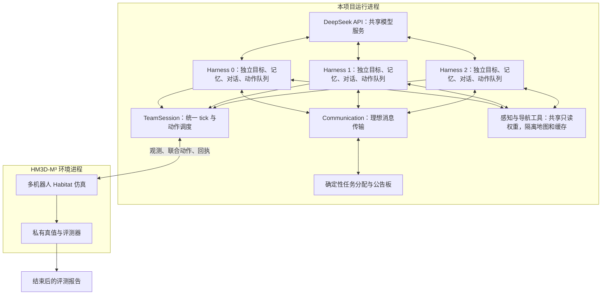

# HM3D-M³ × Communication-Native Agent Harnesses：V0 设计

设计日期：2026-11-07。本文保留最初方案与当时检查结果。2026-11-08 已开始按用户要求在 `192.168.31.225:/home/pyq/comm_harness/` 实现并联调；实际实现范围与启动方法见 [README](../README.md)。下文“建议/尚未”均指原设计时状态，不应代替当前实现记录。

## 1. 第一版的定位

**在同一个 HM3D 场景中运行 K 个独立的 harness，分别管理 K 个机器人，通过理想消息网络协作完成 M 个多模态目标。DeepSeek 负责决策，本地工具负责感知、导航、验证和执行，HM3D-M³ 负责环境与最终评测。**

借鉴 RPent 的工程边界，吸收 HarnessVLN 的导航记忆与执行闭环，不把两个完整项目层层套在一起。方法名称继续使用当前工程名称。

- RPent 提供工程参考：`Planner + Toolkit + PlatformSpec + Session`。
- HarnessVLN 提供能力参考：任务记忆、世界图、证据检索、回退、目标复核、动作回执。
- HM3D-M³ 提供任务定义：K 个起点、M 个目标、RGB-D 观测、多机器人仿真、评测指标。
- 本项目新增的核心边界：**每个节点拥有独立状态，所有跨节点信息都经过可替换的通信层。**

第一版属于多机器人仿真。AP、基站、USRP 尚不参与这个实验；将来可以注册为具有不同工具集的节点。当前 Habitat 机器人也不等同于真实阿克曼底盘，单独命名为 `hm3d_m3` 平台。

## 2. 已核实的起点

| 项目 | 本轮核实结果 |
| --- | --- |
| 运行主机 | `pyq@192.168.31.225`，SSH 连接成功 |
| 环境 | `/home/pyq/hm3d_m3_repro/envs/m3/`，Python 3.8.20；可定位 habitat、habitat_sim、torch、openai、cv2、transformers 包 |
| 场景 | 100 个普通场景网格、36 个语义网格、36 个语义文本文件 |
| 当前任务集 | `ma_official_mini_100_samefloor_mixed3_kmquota_seed1123.json`，100 个 episode，覆盖 36 个场景；100 个任务的场景网格均存在 |
| 目标组成 | 共 392 个目标：ON 132、TN 127、IIN 133 |
| IIN 素材 | `iin_images_official_mini100_mixed3_stretch512/`；manifest 记载 133 项、121 张不同图像，目录有 133 个 PNG 文件；未逐张验证解码和任务映射 |
| 目标图相机 | manifest 中为 512×512、HFOV 42°、高度 1.31 m；目标图相机与机器人观测相机分别记录 |
| 场景复用 | HarnessVLN 的场景路径为已有 HM3D 数据的软链接 |
| 本机/远端源码 | `ma_search.py`、`metrics.py`、`multi_sim.py` 忽略换行差异后完全一致 |
| 已有单机结果 | 既有 smoke 报告记录 success=0、SPL=0；它证明环境曾运行，不能作为多机方法有效的证据 |
| DeepSeek | `/models` 返回 `deepseek-flash` 和 `deepseek-v4-pro`；本轮实际测试了 `deepseek-flash` 的图片输入、原生工具调用及工具回传 |

DeepSeek 测试使用一张临时合成图片，不包含场景数据。两次生成请求均 HTTP 200：先识别红色并调用测试工具，再读取工具结果回复 OK；累计 usage 为 1,149 tokens。它只验证接口协议，不验证导航、实例辨认或 bbox 定位质量。本轮调用发生在本机，服务器对 DeepSeek 的网络连通性仍需在部署时验证。

任务文件 SHA-256：`ce7c68fe760e0bb11b72e0d4ec6723da786daf1dfd4bda23a79f72d61c07a13b`。

这些是当前部署副本的事实；不能把 100 个任务、100 个场景网格、完整训练集混为一谈。

## 3. 保持现有文件夹结构

只增加一个平台目录，公共框架不增加新的顶层模块：

```text
code/
├── comm_harness/
│   ├── cli/                 # 加载实验配置、启动会话
│   ├── planner/             # DeepSeek 接口、对话与工具调用循环
│   ├── tools/               # 工具注册、参数校验、执行与回执
│   ├── platforms/           # PlatformSpec、Observation、Action 等公共契约
│   ├── session/             # 每节点 harness 状态、团队调度、日志
│   └── communication/       # 消息协议、理想传输、任务分配与团队公告
├── platforms/
│   ├── hm3d_m3/             # 新增：任务加载、感知导航适配、仿真与计分
│   ├── uav/
│   ├── ackermann/
│   └── usrp/
├── examples/                # 本设计与后续实验配置
└── tests/
```

目录中的职责划分是实现目标，不代表已经存在这些类。第一版把节点记忆放在 `session/`，导航特有的地图处理放在 `platforms/hm3d_m3/`，暂不增加 `memory/`、`agents/`、`services/` 等目录。

## 4. 运行时的组成



**独立 harness 不要求独立 GPU、独立模型权重或独立进程。** V0 可以在一个主进程内创建 K 个实例，共用一个 DeepSeek 端点和感知模型权重；每个实例的对话、任务状态、地图、证据、失败记录和动作队列必须隔离。共享权重的模块若带可变缓存，缓存也必须按节点隔离。

两个参考仓库都定义了 `vlnce_baselines` 和 `habitat_extensions`。不能把两者同时塞进一个进程的导入路径。V0 采用以下边界：

- 环境子进程只加载 HM3D-M³ 源码，拥有 simulator 和 evaluator。
- 本项目进程加载自己的框架和经适配的 HarnessVLN 导航能力。抽取的纯模块放入本项目命名空间，并保留来源与许可说明。
- 环境边界只提供 `reset / step_joint / close` 和类型明确的消息；不提供任意 Python 执行或真值查询接口。
- 两进程的环境传输是运行基础设施；机器人之间的协作消息才进入实验通信统计。云端 DeepSeek 流量单列统计。

这只是解决现有依赖冲突的一条进程边界，不需要把 K 个机器人拆成 K 套服务。

## 5. 第一个完整任务

选择已有单机 vase smoke 所属的原始 episode：`00849-a8BtkwhxdRV_01257`。保持原始三个起点与全部五个目标，不用单目标转换文件代替完整任务。

| 公共目标 ID | 类型 | 给策略的目标内容 | 评测语义 |
| --- | --- | --- | --- |
| `g0` | TN | 悬垂的绿色植物及其与棕色物体的关系；传入原始完整英文描述 | 指定实例 |
| `g1` | ON | vase | 类别可达点集合 |
| `g2` | TN | 开着的木门右侧、深色木框的镜子；传入原始完整英文描述 | 指定实例 |
| `g3` | ON | radiator | 类别可达点集合 |
| `g4` | IIN | stair 的目标参考图，并清楚标记为“目标图” | 指定实例 |

公共 ID 由 `episode_id + goal_index` 确定，不依赖原始数据存在 `goal_id` 字段。该 episode 的 IIN 图片是 `00849-a8BtkwhxdRV_01257__g4_stair.png`，已经确认存在。

策略可以读取：目标类别/文字/参考图、自身 RGB-D、允许的自身定位观测、已观测局部地图、通过通信收到的信息。

策略不能读取：目标真值位置、`object_id`、`rep_point`、`reach_points`、`instance_reach_points`、`iin_viewpoint`、完整场景语义地图、oracle 路径或分配。参考图可以由已有 manifest 定位；其拍摄坐标不进入策略输入。任务加载器按允许字段构建公共对象，不能把原始 episode 字典交给 planner。

V0 另外假设**准确自身定位和已知公共坐标系**。这与“理想通信”是两个独立假设，实验配置分别记录。队友位置只有经过消息传输后才可见。

## 6. 一个节点的闭环与工具

```text
RGB-D / 位姿 / 收到的消息
    → 本地地图、候选物体、任务与证据更新
    → 构造有限大小的上下文
    → DeepSeek 返回工具调用
    → Toolkit 校验参数、权限、证据与任务版本
    → 导航工具生成原子动作队列
    → TeamSession 执行联合动作
    → 观测与执行回执回到所属 harness
```

模型在关键决策点调用：初始探索、到达候选位置、队列执行失败、需要重新分工、需要目标复核。FMM 执行每个前进或转向动作时不必再请求大模型。

建议第一版只暴露以下 8 类工具，具体工具实现属于平台或通信模块：

| 工具 | 作用 | 约束 |
| --- | --- | --- |
| `observe` | 读取当前观测，或请求全景扫描 | 全景扫描占用真实仿真 tick |
| `recall` | 检索本节点已有的地点、目标和失败证据 | 不能查询未收到的队友记忆 |
| `navigate` | 前往已知 frontier、候选物体或历史地点 | 传候选 ID；只使用观测地图规划 |
| `verify_goal` | 用当前证据按 ON/TN/IIN 类型复核 | 返回验证结果和证据 ID，不宣布评测成功 |
| `declare_goal` | 提交某一目标的发现声明 | 绑定目标、当前观测、几何验证与验证回执 |
| `read_team_state` | 读取本节点已收到的团队状态 | 不同步读取中央板的最新 Python 对象 |
| `publish` | 发送候选物体、探索摘要或求助消息 | 序列化、计量、记录接收者 |
| `request_assignment` | 请求领取、释放或变更任务 | 携带版本号，收到确认后生效 |

`navigate` 的返回首先可以是“已接受命令 + command_id”，实际完成回执由调度器随后送达。机器人回退到历史地点也用这个工具，无需另造一套执行器。

感知端优先使用现有检测/分割模块产生带 ID 的候选区域，再由 DeepSeek 选择和解释。需要 VLM 输出 bbox 的路径必须标注图像尺寸、坐标制并校验范围；已有 smoke 的 `MODEL_BBOX_SCALE=pixel` 不能证明所有后续模型和图片都定位正确。

失败、API 超时、无效工具名、过期证据均产生明确回执，不转成“默认前进一步”或“目标已找到”。V0 可以有限重试两次，之后该节点 HOLD 并记录错误；持续故障或总预算耗尽结束为不完整运行。

## 7. 如何对接 DeepSeek

第一版由 `planner/` 直接调用 DeepSeek 的 Chat Completions API。这里 DeepSeek 是模型服务，本项目是负责状态、工具和执行闭环的 harness；这条路径不需要 Codex。

配置只保存环境变量名，不保存密钥：

```yaml
planner:
  provider: deepseek
  base_url: https://api.deepseek.com
  model: deepseek-flash
  api_key_env: DEEPSEEK_API_KEY
  thinking: disabled
  max_output_tokens: 1024
  max_tool_rounds_per_decision: 8
```

实际请求包含三部分：

1. system：节点身份、任务规则、允许的工具、如何区分观测和目标参考图。
2. user：当前目标、任务/通信状态摘要、选取的 RGB 图像和证据标签。图片用 `image_url` 数据块，不能仅发送服务器上的文件路径。
3. tools：工具名称、说明和参数 JSON Schema。

模型返回 `tool_calls` 后，harness 解析并校验参数、执行工具，将结果以相同 `tool_call_id` 回传。工具结果中的图片在 Chat 接口中通过带证据标签的后续 user 图片消息提供。自动到达的环境观测和队友消息也作为上下文消息提供，不伪造模型未发起的工具调用。

上下文从当前观测、目标参考图、相关历史和已送达消息中选择。建议起点为当前/全景最多 4 张 + 当前 IIN 目标图 1 张 + 最相关历史 2 张；这只是可调实验配置，不能删去当前任务必需的参考图。

Depth 通常用于本地投影与距离验证，不需要把整个深度矩阵转成自然语言。结构化状态以 JSON/文本摘要提供；RGB 和 IIN 参考图保留为图像输入。每个节点保持自己的 messages。

模型名、日期、请求参数、usage 和延迟写入结果，API 密钥不写入日志。由于服务端模型可能更新，固定同一实验批次的配置并记录返回的模型标识。

官方接口依据：[模型与接入](https://api-docs.deepseek.com/)、[图像输入](https://api-docs.deepseek.com/guides/vision/)、[工具调用](https://api-docs.deepseek.com/guides/tool_calls/)。以上协议在本轮小测试中已验证；并发能力、真实场景定位和服务器连通性尚未验证。

## 8. 理想通信仍然走消息网络

`communication/` 同时定义消息协议与可替换传输。V0 使用 `IdealTransport`：可靠、有序、无限带宽、无传播延迟。

最小消息信封包含：

```text
message_id, episode_id, sender, recipients, sequence,
created_tick, delivered_tick, kind, schema_version,
goal_id / assignment_version, ttl_ticks,
payload, attachment_ids, serialized_bytes
```

消息类型先固定为：`status`、`candidate`、`exploration_summary`、`assignment_request`、`assignment_ack`、`goal_claim`。不让模型自由创造新协议。

- 任务板由一个确定性协调器维护。初始化按目标顺序轮转分配；位置未知时不按目标真值做“最近机器人分配”。
- 每个机器人有一个当前主目标，允许顺路发现其他目标。目标多于机器人时保留待办队列。
- 发现候选后，可依据已分享的候选位置、本地可达性和工作量调整分工；未知路径成本保持 unknown，不当成零。
- 任务领取按版本比较后更新；旧版本请求被拒绝并返回新版本。所有请求和确认都经过传输层。
- 初版共享目标声明、候选证据、位姿和探索摘要；局部地图独立保存。完整共享地图作为独立消融项，不默认把所有地图堆成全局真值。
- 图片引用不会自动赋予接收者读取发送方文件的权限。接收方要使用图片，图像字节必须作为附件实际经过消息层，并计入发送量。
- 同步全局日志可以供研究者离线分析，但任何节点不能通过日志读取未收到的信息。

每个 tick 有确定顺序：投递上轮待发消息 → 协调器处理申请并发送确认 → 形成各节点收件箱快照 → 节点决策与队列调度 → 执行联合动作 → 记录新观测和消息。决策期间新生成的消息在下一次消息阶段可见；V0 的“零网络延迟”不取消这个软件调度边界。

发送量明确统计：UTF-8 序列化信封、载荷和实际编码附件。广播另记一次源发送字节数与各接收链路累计字节数，避免把复制次数混为同一种指标。这里是应用层通信量，尚不包含无线 PHY/MAC 开销。

## 9. 一个环境时钟，避免伪多机并行

TeamSession 是唯一发出 `step_joint([a0, a1, ..., aK-1])` 的组件。各机器人只能提交动作，不能从工具内部偷偷推进环境。

- 每个 tick 每个机器人至多执行一个底层动作；无动作时 HOLD。
- 一次全景扫描中的 12 次 30° 转向要展开为 12 个联合 tick，其他机器人同期执行自己的队列。
- FMM 路径、扫描、回退都是可暂停和可取消的命令。取消发生在 tick 边界，已执行动作保留在日志中。
- V0 在模型请求期间冻结仿真推进；模型请求可并发，但动作执行遵循同一个时钟。分别统计逻辑 tick、移动路程和模型/API 的墙钟耗时。
- 当前 `MultiAgentSimulator` 把底层 `STOP` 当作原地保持。框架中显式称为 HOLD；目标声明、节点放弃和团队结束分别处理。
- 全员 HOLD 时框架仍推进逻辑 tick，避免只转向、等待或失败重试绕过步数预算。

后续加入秒级无线时延前，要为原子动作设定或标定持续时间，再将网络事件映射到统一仿真时间。不能直接把 DeepSeek 实际响应的几秒钟当成机器人间无线时延。

## 10. 目标验证与评测隔离

策略侧状态：`PENDING → ASSIGNED → VERIFYING → CLAIMED_FOUND`。失败复核返回搜索状态。策略侧不出现由评测器写入的 `TRUE_SUCCESS`。

| 类型 | 策略侧复核 |
| --- | --- |
| ON | 当前图像中存在目标类别，结合当前有效深度/地图确认已接近可观察位置 |
| TN | 对照完整文字属性和关系复核实例，并检查当前几何条件；不能只核对类别 |
| IIN | 对照目标参考图与当前观测做实例匹配，再检查当前几何条件；不能把目标参考图当成已见证据 |

证据使用 `episode/node/tick/view` 命名。声明绑定具体目标和当前验证回执。队友的旧图像只能提供候选线索，不能替代声明节点的当前到达证据。验证异常、缺少目标图、深度无效时返回 unknown/failed。

`declare_goal` 写入策略声明记录和通信消息；所有目标都被策略声明后，可结束执行。然后由私有 evaluator 用声明位置和原始目标语义检查声明：ON 使用 category_union，TN/IIN 使用 target_instance。该 episode 的成功距离为 1.0 m。虚假声明计入 false positives；团队自认为完成不等于最终 SR=1。

当前源码存在自动接近目标计分与结束后声明计分两条分支；其中旧 `_verify_goal` 在部分缺失/异常情况下会返回 True。新工具验证不沿用这种兜底。V0 采用明确的“策略声明 + 结束后私有真值核验”协议，并在结果中记录协议名称。与基线比较时，必须让基线使用同一协议；不能把自动到达计分结果直接混入。

复用 `benchmark.metrics.team_metrics / aggregate`，输入经过 evaluator 核验的 `goals_found`，不输入原始声明：

- **SR**：一个 episode 全部 M 个目标成功才为 1。
- **Progress**：每个 episode 找到的目标比例，再对 episode 求平均。
- **SRAT**：所有 episode 找到的目标总数 / 所有目标总数，即微平均。
- **MSPL**：沿用原代码；其 team makespan 是各机器人路径长度的最大值，不是墙钟秒数。
- 同时报告各节点路径、误报、重复探索、应用层通信量、模型调用/token、模型耗时、团队执行耗时。

ON/TN/IIN 分项指标和通信信息年龄等另作明确命名的扩展统计，不冒充原 `aggregate` 已实现的输出。

## 11. 复用哪些源码，改动哪些边界

| 来源 | 使用方式 | 必须补充/调整 |
| --- | --- | --- |
| RPent `planner/base.py` | 借鉴 planner 与工具集解耦的接口 | DeepSeek 原生模型循环；支持决策暂停后由团队 tick 继续 |
| RPent `tools/toolkit.py` | 借鉴工具注册、参数校验、结果统一封装 | 节点权限、证据有效性、动作互斥、消息发送权限 |
| RPent `robots/robot_spec.py` | 对应本项目 PlatformSpec | 身份、提示词、工具工厂与生命周期；不包含平台私有实现 |
| HarnessVLN `harness/state.py`、`todo.py`、`world_graph.py`、`retrieval.py` | 复用/适配导航记忆和证据检索思路 | 每节点隔离；按目标区分失败记忆；证据 ID 增加节点命名空间 |
| HarnessVLN `ZS_Evaluator_mp.py` | 提取全景、FMM、回退、停止复核的行为 | 把 `_harness_step` 中环境推进移到 TeamSession；全景拆为原子 tick |
| HarnessVLN `harness/runtime.py` | 参考观测/调用/回执追踪 | 当前 strict_receipts 未实际强制执行；需要在本项目工具执行入口真正拒绝违规调用 |
| M³ `multi_agent/multi_sim.py` | 复用 K 机器人仿真 | 联合动作唯一入口，明确 HOLD 语义 |
| M³ `benchmark/ma_search.py` | 参考 episode、目标图解析和声明计分 | 公共目标与私有真值分离；不复用其整套策略调度器 |
| M³ `benchmark/coord_shell.py` | 参考协作接口与通信记账 | 它不是现成的完整调度器，任务板与传输语义由本项目实现 |
| M³ `benchmark/metrics.py` | 复用指标与聚合 | 固定版本，正确提供经核验的结果 |

这不是对 HarnessVLN 论文结果的原样复现，而是吸收其能力来实现一个新的多节点框架。参考代码若被复制，保留原许可与署名；不直接把要求较新 Python 的完整 RPent 依赖装进现有 Python 3.8 环境。

## 12. 配置、部署与实施顺序

部署位置按用户最新要求确定为服务器 `/home/pyq/comm_harness/`，复用现有环境和数据。每次结果写到独立 run 目录，保存配置、源版本、事件、通信记录、轨迹、声明和最终指标。

建议 V0 默认：DeepSeek `deepseek-flash`、非 thinking、FMM 执行、理想通信、准确定位/公共坐标系、K/M 由 episode 决定。调试入口先固定上述 3 机器人 5 目标任务，随后使用原 mini100。

仿真配置以 M³ `vlnce_baselines/config/multi_objectnav_v2.yaml` 及其引用的 task config 为起点，读取 K 后扩展 agent 配置。当前 task config 定义机器人高 0.88 m、半径 0.18 m，RGB-D 640×480、HFOV 79°、相机高 0.88 m、前进 0.25 m、转向 30°。启动后还要保存实际解析值及 navmesh 设置，不能只保存 YAML 文件名。既有单机 smoke 使用的半径 0.1 m 不直接带入此方案。

预算默认沿用 M³ 路径预算并设联合步数上限 300：该调试 episode 的 `budget_geo=19.583 m`，按现有 runner 的每节点路径预算语义应用。若另做关闭路径预算的实验，单独标记并给全部对比方法一致配置；不能和历史 `--disable-path-budget` 结果直接比较。模型 token/调用预算也统一，不让某个通信方案获得额外推理预算。

| 阶段 | 具体交付 | 通过条件 |
| --- | --- | --- |
| P0：接入契约 | 类型、DeepSeek 循环、工具校验、理想传输、假平台 | 工具调用闭环；节点隔离；无密钥日志；无非法动作；错误可见 |
| P1：多机环境 | HM3D-M³ 环境桥、三个节点、联合动作、完整任务输入 | 三个起点正确；观测不串号；全景步数正确；所有 IIN 图可解码并映射；真值不进入策略 |
| P2：导航闭环 | 局部地图、候选/FMM、回退、三种目标复核 | 运行原始 3×5 任务，产出可回放的轨迹、声明和原指标；失败有可定位原因 |
| P3：理想协作 | 任务板、候选共享、任务领取/重分配 | 无重复执行副作用；相同任务版本冲突可处理；收到的消息确实影响策略 |
| P4：评测 | 固定版本的 mini100 与消融 | 预先固定测试集和预算；报告成功和失败，不能只挑选成功任务 |

优先测试真正影响正确性的行为：重复消息不重复执行、过期版本不能领取任务、证据不能跨节点冒用、全景不会越过团队时钟、TN/IIN 不退化成类别任务、错误声明不会计入成功、模型故障不会伪装成成功。

调试可使用单目标 ON 子任务定位问题，但必须标为开发测试。只有完整 3×5 与后续 mini100 结果才能用于多机器人多模态任务结论。能运行完毕属于工程验收，性能优于基线需要实验数据证明。

最小消融保持模型、工具、感知、预算和 episode 不变，比较：独立节点；仅共享声明；共享声明与候选；再增加动态分配。先验证每个模块是否产生收益，不预设完整版本一定更优。

## 13. 后续真实通信怎么加入

| 版本 | 增加的能力 | 保持的边界 |
| --- | --- | --- |
| V0 | 可靠、零传播延迟、无限带宽 | 仍有消息、序号、时间、附件和字节统计 |
| V1 | 延迟/抖动、带宽队列、丢包/重复/乱序、断连 | 相同工具和消息格式；节点只看到已交付的信息 |
| V2 | 随位姿变化的链路、AP 关联、无线资源与竞争 | 网络状态由传输/网络模型提供；不改导航策略的基本接口 |
| V3 | 真实 ROS2/无线链路/USRP 或网络仿真对接 | 各平台替换观测与执行适配，复用 harness 和通信协议 |

V1 不能只给 send 加 sleep：需要调度消息交付、限制附件传输、处理任务板旧版本、确认丢失与重发、断连时本地继续探索和重连后的合并。重发用 message_id 去重，lease 只在定义了时钟与协调器权限后引入，不声称消息网络提供 exactly-once。

第一版中的协调器是协议服务，不是新增的大模型领导者，也不是已实现的 AP 智能体。未来可以将它部署到 AP/边缘节点；节点与协调器之间的消息同样受链路条件影响。断网时不能仍通过共享内存获得最新分配。

后续研究可比较消息内容选择、发送时机、目标/地图/图像的带宽分配，以及旧信息导致的决策损失。V0 已保留每条消息的产生时间、交付时间、字节与任务关联，因此可以追踪“收到什么信息，在何时改变了哪个节点的决定”。

## 14. 本地阅读入口

- [原多机设计](<F:/实验室相关/论文/Multi-Robot HarnessVLN/reproduction/MULTI_HARNESS_V0_DESIGN.md>)：本设计承接其每节点独立状态、理想通信、同步步进和评测隔离原则。
- [已有单机 smoke 报告](<F:/实验室相关/论文/Multi-Robot HarnessVLN/reproduction/HARNESSVLN_SMOKE.md>)。
- [M³ 目标与声明处理](<F:/实验室相关/论文/Multi-Robot HarnessVLN/hm3d-m3-code/sim-code/benchmark/ma_search.py>)。
- [M³ 指标](<F:/实验室相关/论文/Multi-Robot HarnessVLN/hm3d-m3-code/sim-code/benchmark/metrics.py>)。
- [M³ 多机器人仿真](<F:/实验室相关/论文/Multi-Robot HarnessVLN/hm3d-m3-code/sim-code/habitat_extensions/multi_agent/multi_sim.py>)。
- [HarnessVLN 导航与执行](<F:/实验室相关/论文/Multi-Robot HarnessVLN/harnessvln-code/vlnce_baselines/ZS_Evaluator_mp.py>)。
- [HarnessVLN 追踪运行时](<F:/实验室相关/论文/Multi-Robot HarnessVLN/harnessvln-code/vlnce_baselines/harness/runtime.py>)。
- [RPent 固定参考版本](https://github.com/RLinf/RPent/tree/c41c0e6c3dc44e3347070ac1361bc2c288901873)：参考 `planner/base.py`、`tools/toolkit.py`、`robots/robot_spec.py`。
